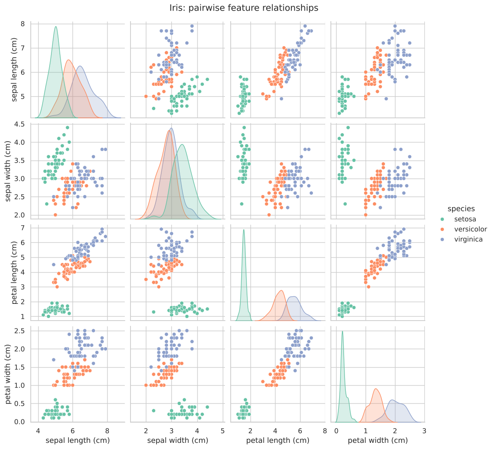
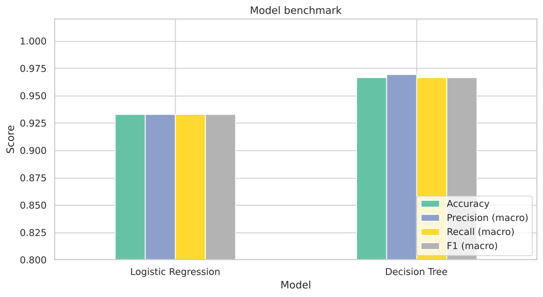
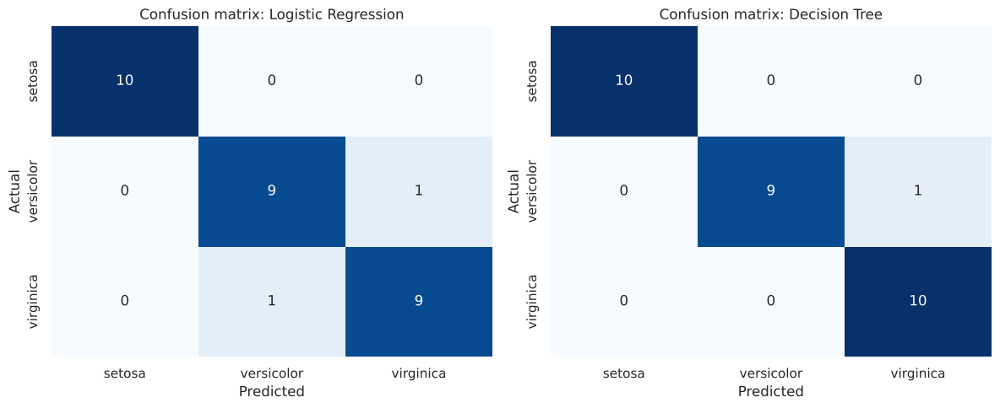
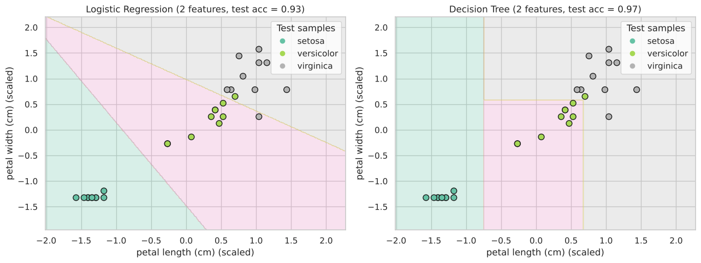

# 🌸 Task 1: Multi-Class Benchmark Classification Pipeline


An end-to-end supervised classification pipeline on the **Iris dataset** that benchmarks **Logistic Regression** against a **Decision Tree** and evaluates them with a full set of metrics and visual diagnostics.

📓 **Notebook:** [`notebooks/01_classification_pipeline.ipynb`](notebooks/01_classification_pipeline.ipynb)

## 🎯 Objective
Build a clean, leakage-safe classification workflow and compare two interpretable models on accuracy, precision, recall and F1-score.

## 🔄 Workflow
1. **Load & inspect** the data with Pandas (shape, class balance, missing values)
2. **Explore** feature relationships with a Seaborn pairplot
3. **Split** 80/20 with stratification so each class keeps its proportion
4. **Scale** features with `StandardScaler`, fitted on the training set only to prevent data leakage
5. **Train** `LogisticRegression` and `DecisionTreeClassifier` (`max_depth=3` to limit overfitting)
6. **Evaluate** with accuracy and macro precision, recall and F1, plus full classification reports
7. **Visualize** confusion matrices and 2D decision boundaries

## 📊 Results (held-out test set, 30 samples)

| Model | Accuracy | Precision | Recall | F1-score |
|-------|:--------:|:---------:|:------:|:--------:|
| Logistic Regression | 0.933 | 0.933 | 0.933 | 0.933 |
| Decision Tree | **0.967** | **0.970** | **0.967** | **0.967** |

### Exploratory analysis


### Model comparison


### Confusion matrices


### Decision boundaries (petal length vs. petal width)


## 💡 Key insights
- *Setosa* is perfectly separable; nearly all errors occur between *versicolor* and *virginica*, whose features overlap.
- Logistic Regression yields smooth linear boundaries. The Decision Tree yields axis-aligned regions that are easy to interpret.
- The two models differ by a single test sample, so with only 30 test points the gap is **not statistically conclusive**.

## 🔭 Next steps
- Use **k-fold cross-validation** for a more robust comparison
- Tune hyperparameters with `GridSearchCV`
- Extend the pipeline to the **Wine** dataset and add more models (Random Forest, SVM)

## 🧱 Code structure and tests
- `notebooks/01_classification_pipeline.ipynb`: the readable report (self-contained)
- `src/iris_pipeline.py`: the same pipeline as typed, documented, logged functions (`load_data`, `split_data`, `scale_features`, `train_models`, `evaluate_models`)
- `tests/test_iris_pipeline.py`: 11 pytest tests (schema validation, missing/invalid values, stratified split, no data leakage in scaling, metrics)

## ▶️ Run it
```bash
pip install -r ../requirements.txt
jupyter notebook notebooks/01_classification_pipeline.ipynb
```
Or run the tested pipeline from the command line:
```bash
python src/iris_pipeline.py --data data/iris.csv
```
