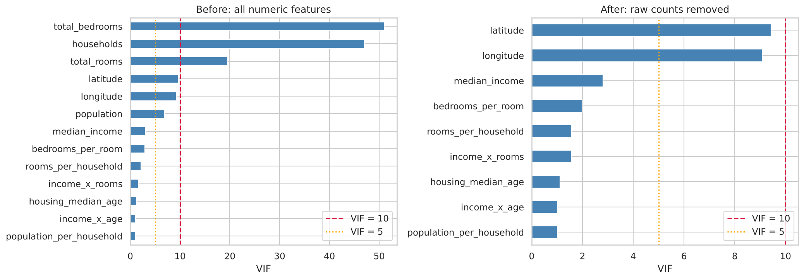
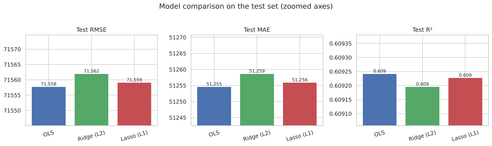
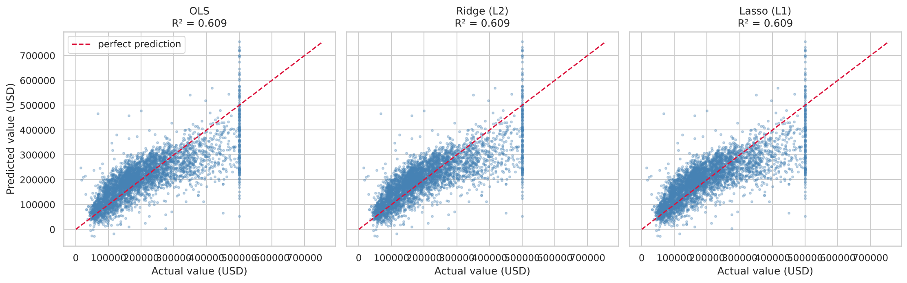
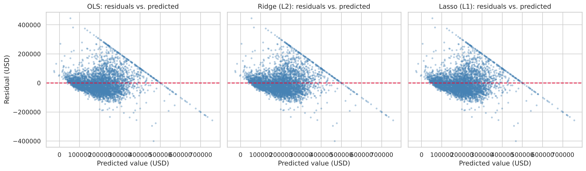

# 🏠 Task 2: Real Estate Housing Price Prediction (OLS, Ridge & Lasso)


Regression pipeline on the **California Housing** dataset (20,640 districts) that predicts median house values and compares **Ordinary Least Squares (OLS)**, **Ridge (L2)** and **Lasso (L1)** regression using RMSE, MAE and R², including feature engineering, multicollinearity analysis and residual diagnostics.

📓 **Notebook:** [`notebooks/02_housing_regression.ipynb`](notebooks/02_housing_regression.ipynb)

## 🎯 Objective
Predict median house values, handle missing values and multicollinearity, engineer interaction features and find out when regularization (Ridge/Lasso) actually helps.

## 🔄 Workflow
1. **Load & inspect** the data (207 missing values in `total_bedrooms`, categorical `ocean_proximity`, price-capped target)
2. **Explore** the target distribution, geography and correlations
3. **Split** 80/20 first, so no statistics leak from the test set
4. **Engineer features:** `rooms_per_household`, `bedrooms_per_room`, `population_per_household` and the interaction features `income_x_age`, `income_x_rooms` (centered products)
5. **Check multicollinearity** with Variance Inflation Factors and remove redundant raw count columns (VIF of up to 51 before the cleanup)
6. **Preprocess in a pipeline:** median imputation, standardization, one-hot encoding
7. **Train** OLS, Ridge and Lasso, tuning `alpha` with `GridSearchCV` (5-fold CV)
8. **Evaluate** RMSE, MAE and R² on the held-out test set
9. **Analyze residuals:** predicted vs. actual, residual distributions, residuals vs. predicted, coefficients
10. **Bonus:** expand to 59 pairwise interaction features to show where regularization helps

## 📊 Results (held-out test set, 4,128 districts)

### Cleaned feature set (9 numeric features + location category)

| Model | RMSE (USD) | MAE (USD) | R² |
|-------|-----------:|----------:|:--:|
| OLS | 71,558 | 51,255 | 0.609 |
| Ridge (L2) | 71,562 | 51,259 | 0.609 |
| Lasso (L1) | 71,559 | 51,256 | 0.609 |

### Bonus: all pairwise interactions (59 features)

| Model | RMSE (USD) | MAE (USD) | R² | Notes |
|-------|-----------:|----------:|:--:|-------|
| OLS | 72,839 | 45,892 | 0.595 | overfits (train R² 0.700) |
| Ridge (L2) | **69,748** | 49,162 | **0.629** | best test RMSE and R² |
| Lasso (L1) | 70,118 | 49,862 | 0.625 | keeps 26 of 59 features |

### Multicollinearity (VIF)


### Model comparison


### Predicted vs. actual


### Residuals vs. predicted


## 💡 Key insights
- With cleaned features and 16,500 training rows, **all three models perform the same**, because little multicollinearity is left for regularization to fix.
- Once the feature space grows to 59 correlated columns, **OLS overfits** while **Ridge and Lasso generalize better**; Lasso also drops 33 features.
- `median_income` is the dominant predictor, followed by location.
- The **\$500,001 price cap** (4.8% of districts) distorts the residuals and shows up as a diagonal line in the residual plot.

## 🔭 Next steps
- Repeated cross-validation for more robust estimates
- Handle the capped target explicitly
- Try non-linear models (Random Forest, Gradient Boosting) to capture location effects

## 🧱 Code structure and tests
- `notebooks/02_housing_regression.ipynb`: the readable report (self-contained)
- `src/housing_pipeline.py`: the same pipeline as typed, documented, logged functions (`load_data`, `add_features`, `prepare_data`, `build_preprocessor`, `fit_models`, `evaluate_models`, `compute_vif`)
- `tests/test_housing_pipeline.py`: 14 pytest tests (schema validation, feature engineering, zero-division guards, imputation, VIF, model fitting and metrics)

## ▶️ Run it
```bash
pip install -r ../requirements.txt
jupyter notebook notebooks/02_housing_regression.ipynb
```
Or run the tested pipeline from the command line:
```bash
python src/housing_pipeline.py --data data/housing.csv
```
The notebook reads `data/housing.csv` and downloads it automatically if the file is missing.
