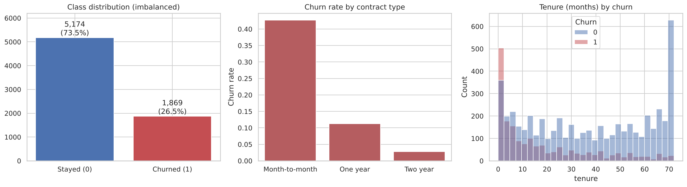
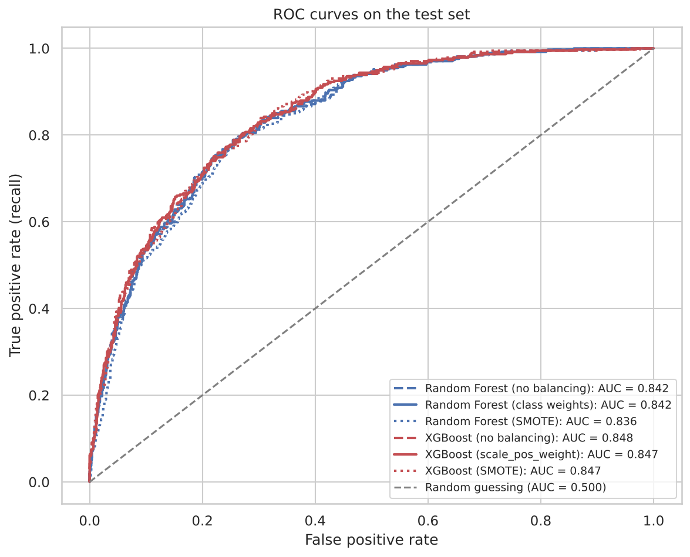
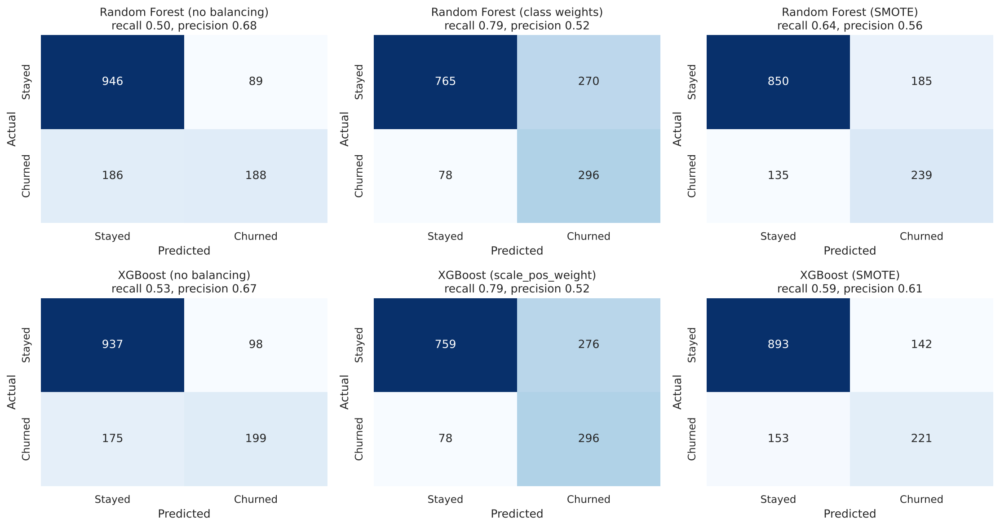
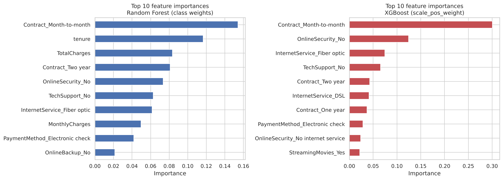

# 📉 Task 3: Predictive Customer Churn Classifier (Random Forest & XGBoost)


Churn prediction on the **Telco Customer Churn** dataset (7,043 customers, 26.5% churn). The project tackles the **class imbalance** with class weights and SMOTE, trains **Random Forest** and **XGBoost** classifiers and evaluates them with ROC-AUC, confusion matrices, precision/recall and feature importances.

📓 **Notebook:** [`notebooks/03_churn_classification.ipynb`](notebooks/03_churn_classification.ipynb)

## 🎯 Objective
Predict which customers will cancel their subscription, reach a **ROC-AUC above 0.80**, and understand how different imbalance strategies change the model's decisions.

## 🔄 Workflow
1. **Load & clean:** `TotalCharges` is stored as text; 11 blank values (new customers with tenure 0) are converted to NaN and imputed with the median
2. **Explore:** class imbalance, churn by contract type, tenure distribution
3. **Split** 80/20, stratified, then preprocess in a pipeline: median imputation and **one-hot encoding**
4. **Balance** the classes: no balancing (baseline), **class weights / `scale_pos_weight`**, and **SMOTE** (inside an imbalanced-learn pipeline, so synthetic samples never leak into validation or test data)
5. **Train** Random Forest and XGBoost with **5-fold stratified cross-validation**
6. **Evaluate** on the held-out test set: ROC-AUC curves, confusion matrices, precision/recall, precision-recall vs. threshold
7. **Explain** with the top 10 feature importances

## 📊 Results (held-out test set, 1,409 customers)

| Model | ROC-AUC | Accuracy | Precision (churn) | Recall (churn) | F1 (churn) |
|-------|:-------:|:--------:|:-----------------:|:--------------:|:----------:|
| Random Forest (no balancing) | 0.842 | 0.805 | 0.679 | 0.503 | 0.578 |
| Random Forest (class weights) | 0.842 | 0.753 | 0.523 | **0.791** | **0.630** |
| Random Forest (SMOTE) | 0.836 | 0.773 | 0.564 | 0.639 | 0.599 |
| XGBoost (no balancing) | **0.848** | 0.806 | 0.670 | 0.532 | 0.593 |
| XGBoost (scale_pos_weight) | 0.847 | 0.749 | 0.518 | **0.791** | 0.626 |
| XGBoost (SMOTE) | 0.847 | 0.791 | 0.609 | 0.591 | 0.600 |

All models exceed the 0.80 ROC-AUC target.

### Exploratory analysis


### ROC curves


### Confusion matrices


### Top 10 feature importances


## 💡 Key insights
- **Balancing barely changes ROC-AUC** (a ranking metric), but it changes the decisions: recall for churners rises from about 0.50 to **0.79** with class weights, at the price of lower precision and accuracy.
- **SMOTE did not beat simple class weighting** here.
- **Accuracy is misleading:** always predicting "stayed" gives about 73.5%.
- The strongest churn signals are a **month-to-month contract**, **short tenure**, missing **online security / tech support**, **fiber-optic internet** and **electronic check** payments. Importance is not causation.
- The differences between Random Forest and XGBoost are within the cross-validation noise (about 0.01 ROC-AUC).

## 🧱 Code structure and tests
- `notebooks/03_churn_classification.ipynb`: the readable report (self-contained)
- `src/churn_pipeline.py`: the same pipeline as typed, documented, logged functions (`load_data`, `split_data`, `build_preprocessor`, `build_models`, `cross_validate_models`, `evaluate_models`, `top_feature_importances`)
- `tests/test_churn_pipeline.py`: 15 pytest tests (schema validation, `TotalCharges` conversion, stratified split, unseen categories, SMOTE only during training, effect of class weights, feature importances)

## 🔭 Next steps
- Hyperparameter search (`RandomizedSearchCV`)
- Permutation importance or SHAP, probability calibration
- Choose the decision threshold from the business cost of missed churners vs. unnecessary offers

## ▶️ Run it
```bash
pip install -r ../requirements.txt
jupyter notebook notebooks/03_churn_classification.ipynb
```
Or run the tested pipeline from the command line:
```bash
python src/churn_pipeline.py --data data/telco_churn.csv
```
The notebook reads `data/telco_churn.csv` and downloads it automatically if the file is missing.
