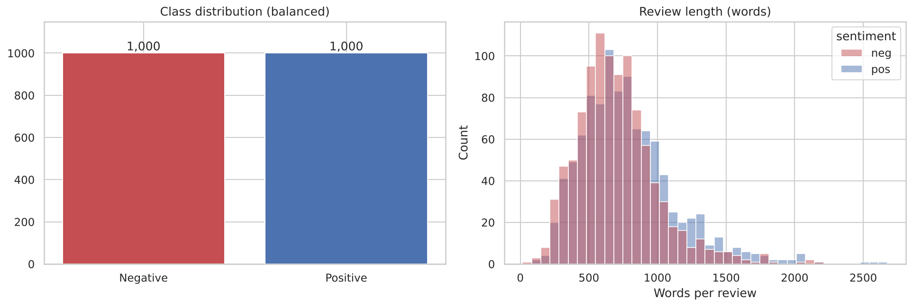
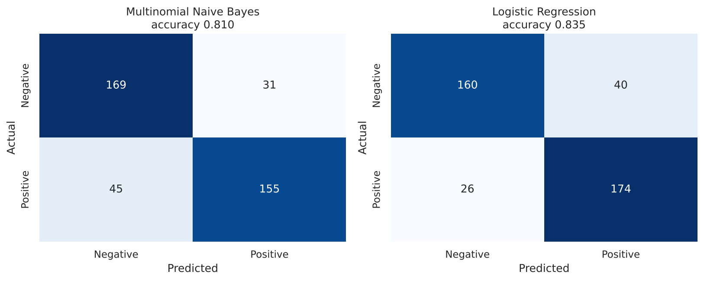
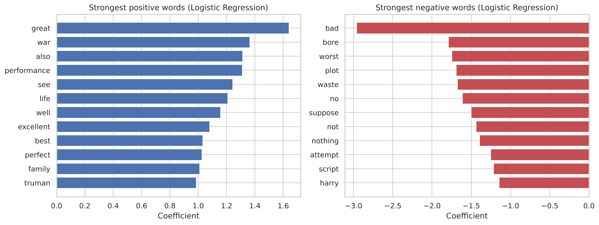

# 💬 Task 4: NLP Sentiment Classification on Customer Reviews (TF-IDF)


A text classifier that decides whether a review is **positive or negative**. Raw reviews are cleaned with NLTK, turned into **TF-IDF** features and classified with **Multinomial Naive Bayes** and **Logistic Regression**. A `predict_sentiment()` function and an interactive helper let you test your own phrases.

📓 **Notebook:** [`notebooks/04_sentiment_classification.ipynb`](notebooks/04_sentiment_classification.ipynb)

**Data:** 2,000 movie reviews (1,000 positive, 1,000 negative) from the NLTK *movie_reviews* corpus (Pang & Lee), stored in `data/movie_reviews.csv`. The task's starter file `data/sentiment_reviews.csv` has only 10 short product reviews, which is too little to train a model, so it is used as an extra test of how well the movie-trained models transfer to product reviews.

## 🎯 Objective
Build an NLP pipeline from raw text to a tested sentiment classifier, benchmark two models and understand which preprocessing choices and words matter.

## 🔄 Workflow
1. **Load & explore:** balanced classes, review length (about 750 words on average)
2. **Preprocess:** lowercase, strip HTML and punctuation, expand contractions, remove stopwords (**negations such as "not" are kept on purpose**), lemmatize with WordNet
3. **Split** 80/20, stratified, and fit `TfidfVectorizer(max_features=5000)` on the training reviews only
4. **Train** Multinomial Naive Bayes and Logistic Regression
5. **Benchmark:** accuracy, precision, recall, F1, ROC-AUC, 5-fold cross-validation, confusion matrices
6. **Interpret:** the words that push a review towards positive or negative
7. **Compare preprocessing variants** with cross-validation (raw text, negations removed or kept, bigrams)
8. **Test live phrases** with `predict_sentiment()` and `interactive_test()`
9. **Test on the starter file** (product reviews) to check how well the models transfer to another domain

## 📊 Results (held-out test set, 400 reviews)

| Model | Accuracy | Precision | Recall | F1 | ROC-AUC | CV accuracy (5-fold) |
|-------|:--------:|:---------:|:------:|:--:|:-------:|:--------------------:|
| Multinomial Naive Bayes | 0.810 | 0.833 | 0.775 | 0.803 | 0.891 | 0.820 ± 0.020 |
| Logistic Regression | **0.835** | 0.813 | **0.870** | **0.841** | **0.915** | **0.840 ± 0.017** |

The majority-class baseline is 0.50.

### Preprocessing comparison (5-fold CV accuracy on the training set)

| Variant | Naive Bayes | Logistic Regression |
|---------|:-----------:|:-------------------:|
| Raw text (no cleaning) | 0.804 | 0.816 |
| Cleaned, negations removed | 0.824 | 0.837 |
| Cleaned, negations kept (final) | 0.820 | 0.840 |
| Cleaned, negations kept + bigrams | 0.824 | 0.842 |

### Test on the starter file (9 product reviews)

| Model | Correct | Accuracy |
|-------|:-------:|:--------:|
| Multinomial Naive Bayes | 6 of 9 | 0.667 |
| Logistic Regression | 5 of 9 | 0.556 |

Close to guessing, with confidences between 0.50 and 0.69. The vocabulary knows 84% of the words, so the likely reason is that the sentiment cues of product reviews differ from those of movie reviews (and the reviews are very short). With 9 reviews these numbers are only indicative, and nothing was tuned on this file.

### Exploratory analysis


### Confusion matrices


### Words that drive the predictions


## 💡 Key insights
- **Logistic Regression is modestly better** than Naive Bayes, but with 400 test reviews the gap is about as large as the cross-validation noise.
- **Cleaning the text adds about 2 points** of accuracy; the effect of keeping negations or adding bigrams is within noise.
- The models also learn **movie names and topics** (for example *truman*, *mulan*, *war*), because the corpus has several reviews per movie.
- **The movie-trained models transfer poorly to product reviews** (5 to 6 of 9 correct on the starter file): for product reviews, train on product reviews.
- **Limitations of `predict_sentiment()`:** it is reliable on clear phrases, but short or negated phrases such as "Not bad, actually quite enjoyable" can be misclassified, because the models were trained on long reviews and ignore word order. A confidence near 0.5 signals an unreliable prediction.

## 🧱 Code structure and tests
- `notebooks/04_sentiment_classification.ipynb`: the readable report (self-contained)
- `src/sentiment_pipeline.py`: the same pipeline as typed, documented, logged code (`preprocess_text`, `TextCleaner`, `build_pipeline`, `evaluate_models`, `predict_sentiment`, `top_words`)
- `tests/test_sentiment_pipeline.py`: 25 pytest tests (text cleaning, negations, lemmatization, schema validation, duplicates, stratified split, TF-IDF size, `predict_sentiment` including empty and unknown input, evaluation on an external file)

## 🔭 Next steps
- Train on a larger set of short product reviews (for example Amazon or Yelp) to match the starter file's domain, and compare with bigrams or a pretrained transformer model
- Cross-validation grouped by movie to measure generalization to unseen movies

## ▶️ Run it
```bash
pip install -r ../requirements.txt
jupyter notebook notebooks/04_sentiment_classification.ipynb
```
Or from the command line:
```bash
python src/sentiment_pipeline.py --data data/movie_reviews.csv --predict "A wonderful film"
```
The notebook downloads the required NLTK data automatically. To test your own phrases, edit `my_phrases` or run `interactive_test()` in a new cell.
